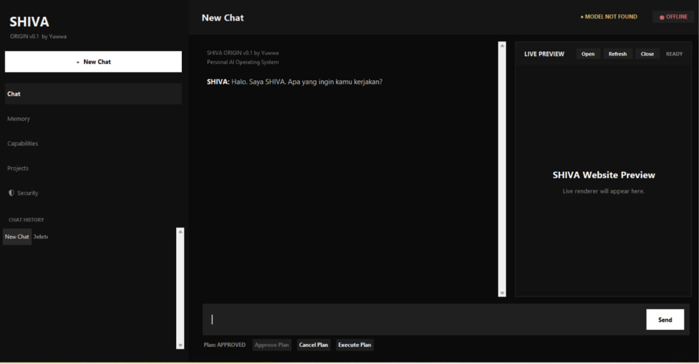

# SHIVA Chatbox

**An experimental AI Chatbox developed as part of the SHIVA Personal AI Operating System project.**

SHIVA Chatbox is an independent development project exploring how AI conversations, local language models, memory, and contextual understanding can work together in a desktop workspace.

## Project Preview

This repository showcases the Chatbox interface and selected components from the SHIVA project.

## Technology

- Python
- Tkinter
- Ollama
- Qwen Models
- Modular Python Architecture

## Project Status

**Active Development — Experimental**

SHIVA Chatbox is not a finished product. Its architecture, interface, and capabilities are continuously evolving.

## Project Goals

- Develop a personal AI chat interface.
- Explore local AI model integration.
- Experiment with conversational context and memory.
- Improve the user experience of AI interactions.
- Explore future integrations with other AI capabilities.

## About the Developer

This project is part of an independent learning and development journey.

I am learning, experimenting, and building SHIVA step by step.

Developers, AI enthusiasts, and curious learners are welcome to explore the source code, share ideas, experiment, and develop their own improvements.

If you build something inspired by this project, feel free to share your experiments and achievements.

## Disclaimer

This repository contains experimental development code. Not all components are independently runnable, fully tested, or production-ready.

---

**SHIVA — Building a unified AI workspace, one step at a time.**

## SHIVA Chatbox Preview

